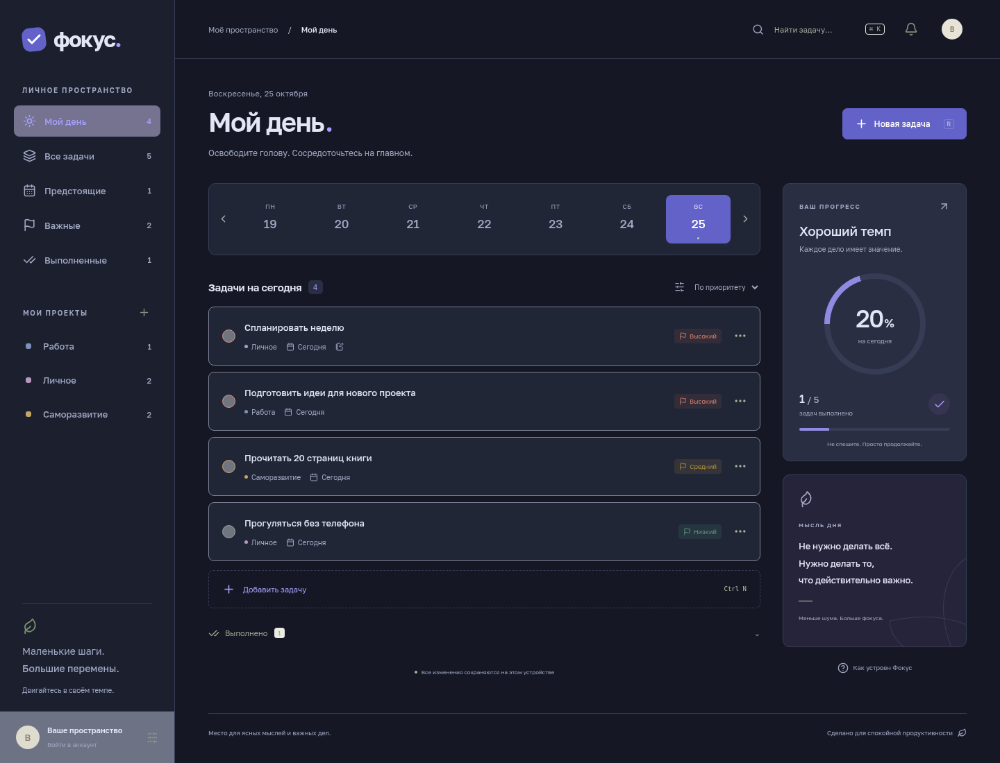

# Фокус 2

**[Скачать приложение](https://github.com/Akame3213/todo-list/releases/latest)** · **[Настройка сервера Windows 10 + Gmail](server/SETUP-WINDOWS.md)**

Настольный список задач на русском языке: проекты, приоритеты, заметки, точные сроки и время напоминаний, системные и почтовые уведомления, светлая и тёмная темы, аккаунты, профиль с фотографией, описанием и цветом. Можно пользоваться локально без сервера или подключить собственный сервер.




## Запуск приложения

Требуются Node.js **24** и npm. Используйте существующий checkout, создавать Git worktree не нужно.

```sh
npm ci
npm run desktop
```

Для разработки интерфейса: `npm run dev`. Для сервера: `npm run server`. Его настройки описаны в [пошаговой инструкции](server/SETUP-WINDOWS.md); SMTP-пароль хранится только в локальном `server/.env`.

## Возможности и ограничения

- Гостевые задачи хранятся в localStorage. Аккаунты, фото и серверные задачи — в SQLite на вашем сервере. После входа задачи гостя не смешиваются с аккаунтом; переносите их через JSON-экспорт и импорт.
- В профиле можно задать имя, фото, описание, цвет и изменить пароль. Пароли хешируются scrypt с индивидуальной солью, сессии ограничены семью днями; сервер хранит хеш токена. После изменения пароля другие сессии отзываются.
- Точное время задачи и напоминание настраиваются отдельно. Напоминания сохраняются с часовым поясом и отображаются в местном времени.
- Закрытие окна Electron сворачивает приложение в трей. Полный выход — через меню трея. Уведомления компьютера требуют запущенного приложения; письма — запущенного сервера, исправного SMTP, подтверждённой почты и успешно сохранённой серверной задачи.
- Письма проверяются каждые 15 секунд; Gmail может задержать доставку. При выключенном/спящем сервере обработка остановлена и продолжится после запуска. После сбоя SMTP повтор через 5 минут; после аварии на границе отправки возможен дубликат.
- Изменения отправляются серверу автоматически. Для загрузки изменений другого клиента повторите вход. При конфликте версий сервер не перезаписывает данные: сначала экспортируйте локальные изменения. Офлайн-копия не ставится в очередь на автоматическое объединение после восстановления связи.
- Сброс забытого пароля, автоматическая синхронизация нескольких клиентов в реальном времени, почтовый OAuth и цифровая подпись сборок пока не реализованы.
- HTTP разрешён для localhost. Для доступа другого устройства нужен HTTPS с доверенным сертификатом. Не открывайте незашифрованный порт 3001 в интернете.

## Проверки

```sh
npm test
npm run build
npx playwright test
npm run test:desktop
```

Серверные тесты используют отдельную SQLite в памяти и тестовый почтовый транспорт: проверяют регистрацию, вход, права доступа, подтверждение адреса, обработку напоминаний, профиль и пароль. Для настоящей доставки Gmail нужно отдельно выполнить тест из инструкции с вашим SMTP.

Playwright запускает сервер и интерфейс, использует `/usr/bin/chromium` (переопределяется `CHROMIUM_PATH`) и проверяет задачи, резервные копии, темы, регистрацию, фото и точное время с сохранением на сервере. Desktop smoke требует графической сессии или Xvfb. В изолированном облачном контейнере тест может запускаться с `FOCUS_TEST_NO_SANDBOX=1`; в поставляемом приложении этот параметр не используется. Проверка IPC не заменяет проверку реального показа уведомлений на пользовательской Windows.

## Сборки

`npm run dist` собирает установщик текущей ОС. Linux и переносимый Windows EXE можно собрать из Linux:

```sh
npm run build
npx electron-builder --linux AppImage --win portable -c.win.signExecutable=false --publish never
```

Сборки появляются в `release/`, не подписаны. Публикация версии через GitHub Actions запускается тегом `v*`; после успешных сборок файлы появляются в GitHub Releases. Сервер устанавливается отдельно из исходников; ни база данных, ни `.env` в сборки и репозиторий не включаются.
