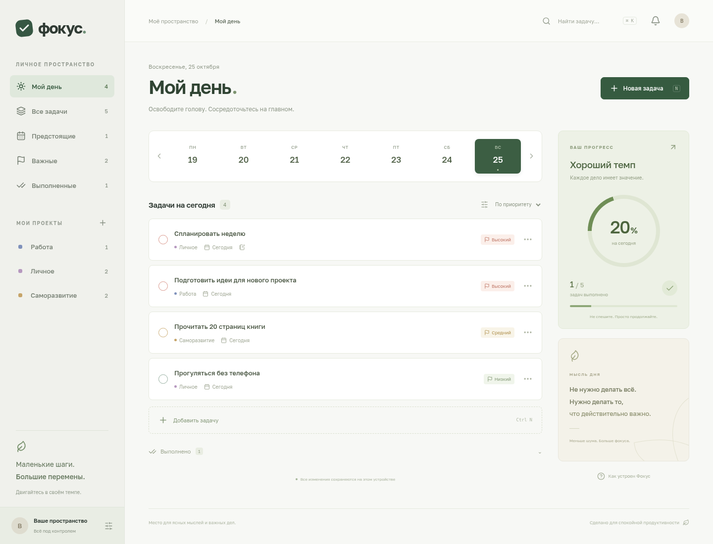

# Фокус

Приложение для спокойного управления задачами на русском языке. Работает в отдельном окне на компьютере (Electron) и в браузере.



Возможности: задачи с заметками, три приоритета, проекты с цветами, сроки, недельный календарь, фильтры, поиск и сортировка, напоминания, статистика дня, завершение и возврат задач, удаление с отменой, экспорт и восстановление JSON-копий. Примеры задач при первом запуске можно редактировать и удалять.

## Запуск

Требуется Node.js 22+ и npm. Используйте существующий checkout: дополнительный Git worktree не нужен.

```sh
npm ci
npm run desktop
```

Команда собирает интерфейс и открывает настольное приложение. Нужна графическая сессия ОС. На Linux также нужны стандартные системные библиотеки Electron (GTK, NSS, ALSA).

Для разработки интерфейса:

```sh
npm run dev
```

## Установщик

```sh
npm run dist
```

Сборка создаётся в `release/`: AppImage на Linux, NSIS на Windows, DMG на macOS. Собирайте установщики на соответствующей ОС. Подпись приложений и нотариализация требуют отдельных сертификатов; в репозитории их нет. Для неподписанных сборок ОС может показывать предупреждение.

В облачной среде подготовлены Linux AppImage и переносимая Windows-сборка без установки. Команда для их повторной сборки:

```sh
NODE_USE_ENV_PROXY=1 XDG_CACHE_HOME=/workspace/.cache ELECTRON_BUILDER_CACHE=/workspace/.cache/electron-builder npx electron-builder --linux AppImage --win portable -c.win.signExecutable=false
```

Эта команда запускается после `npm run build`. Переносимая Windows-сборка не подписана. Её запуск нужно дополнительно проверить на Windows. Сборка NSIS из Linux требует Wine; в текущей облачной среде Wine не установлен.

## Данные и напоминания

Данные сохраняются в localStorage профиля приложения. Интернет и аккаунт не нужны. Браузер и Electron имеют отдельные хранилища. Перед очисткой профиля, переустановкой или переносом на другой компьютер скачайте JSON-копию через «Ваше пространство» внизу боковой панели. Импорт заменяет текущие данные после подтверждения. Облачной синхронизации нет.

Напоминания используют местное время компьютера. В Electron показываются системные уведомления; в браузере нужно разрешение на уведомления. Внутри приложения также появляется сообщение. **Приложение должно быть открыто**: фоновой службы после закрытия нет. Пропущенные напоминания доставляются при следующем запуске. Для уведомлений ОС должна разрешать их показ.

«Мой день» включает незавершённые задачи выбранного дня и более ранних дат. Круг прогресса учитывает только задачи со сроком ровно на выбранную дату.

Горячие клавиши: Ctrl/⌘ + N — новая задача, Ctrl/⌘ + K — поиск, Esc — закрыть диалог.

## Проверки

```sh
npm test
npm run build
npx playwright test
```

Браузерные тесты по умолчанию используют `/usr/bin/chromium`. На другой ОС укажите путь через `CHROMIUM_PATH`. Они проверяют создание и изменение задач, сохранение после перезагрузки, проекты, завершение, удаление с отменой, напоминания, резервные копии и мобильную навигацию.

`npm run test:desktop` проверяет реальное окно Electron, preload-мост, создание задачи, срабатывание напоминания через основной процесс и сохранение после перезагрузки. Нужна графическая сессия или Xvfb. В изолированном облачном контейнере тест запускается с `FOCUS_TEST_NO_SANDBOX=1`; этот параметр не нужен и не используется в обычном приложении. Наличие сообщения внутри приложения не проверяет показ системного уведомления службой уведомлений конкретной ОС.
